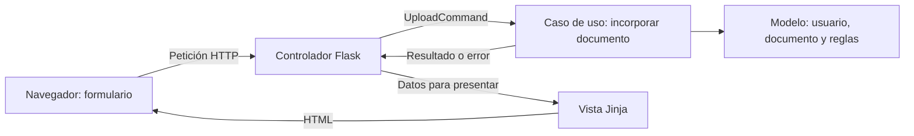
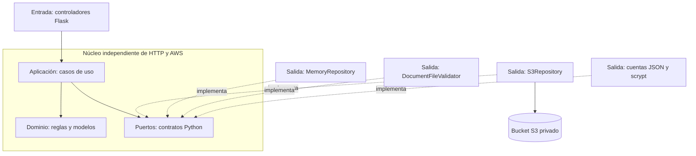
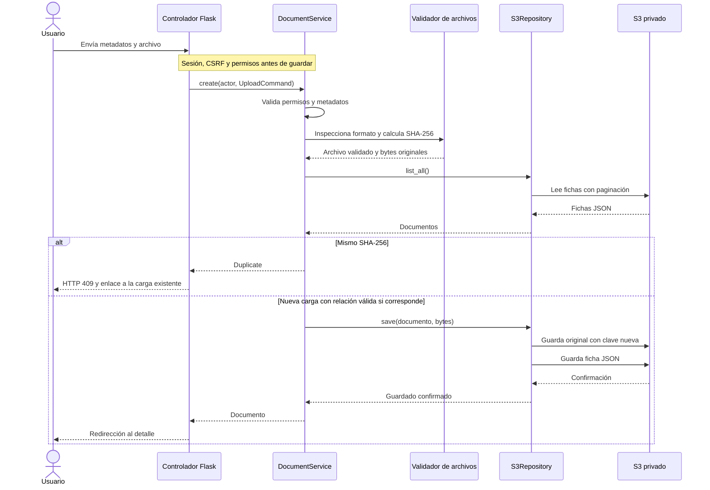

# CargaDocumentosDocIAPlus · MVC y arquitectura hexagonal

Aplicación web en Python para incorporar programaciones didácticas de un centro, conservar el original íntegro y guardar una ficha JSON que permita localizarlo en el futuro. Se ha implementado en una carpeta independiente, siguiendo la [skill de CargaDocumentosDocIAPlus](https://github.com/iesataulfoargentasor/CargaDocumentosDocIAPlus/tree/main/skills/carga-documentos-docia-s3).

La aplicación recibe PDF, DOCX y TXT UTF-8, comprueba su formato y metadatos, detecta copias exactas y permite relacionar una carga como revisión o complemento de otra. El corpus real se guarda en un bucket privado de S3. Incluye un modo de demostración en memoria para aprender el recorrido sin conexión a AWS.

## 1. Descargar y probar en macOS

Instala Python 3.12 o 3.11. Descarga el ZIP desde GitHub y descomprímelo, o clona el repositorio:

```bash
git clone https://github.com/iesataulfoargentasor/CargaDocumentosDocIAPlus_Hexagonal.git
cd CargaDocumentosDocIAPlus_Hexagonal
```

Ejecuta **`Instalar.command`** para crear un entorno virtual propio e instalar las dependencias. Si ya tienes esta instalación preparada, puedes pasar directamente al arranque. El repositorio no incluye `.venv`, cuentas ni configuración privada. Para Windows y Ubuntu consulta la sección 6.

1. Abre **`Iniciar_demo.command`** con doble clic en Finder. Si macOS solicita elegir aplicación, ábrelo con Terminal.
2. El terminal muestra un usuario `demo` y una **contraseña aleatoria exclusiva de esta instalación**. Copia esa contraseña en el formulario del navegador que se abre en **http://127.0.0.1:5053**.
3. En «Subir programación», completa título, IABD, SBD, 2026-2027, borrador/final y procedencia. Selecciona `ejemplos/programacion_sbd.txt`.
4. Consulta la ficha, descarga el original y comprueba que conserva su contenido.
5. Sube el mismo archivo otra vez: se mostrará una copia exacta sin crear otra carga.
6. Sube `ejemplos/programacion_sbd_revision.txt` con el mismo módulo y curso: se solicitará relación, motivo y volver a seleccionar el archivo. Elige revisión para conservar ambos originales.
7. Detén el servidor con **Ctrl+C** en Terminal. Puedes cerrar la ventana después.

**En demostración los documentos solo están en memoria y desaparecen al detener el servidor.** El aviso figura en todas las pantallas. Las credenciales de demostración se conservan en `instance/demo-access.json`, un archivo privado; no sirven para el modo S3. No utilizar documentos reales del centro en las prácticas.

También hay un DOCX, un PDF digital y un PDF con imagen sintética en `ejemplos/`. El PDF con imagen demuestra admisión de un documento sin capa de texto, no OCR ni reconocimiento de su contenido.

No hace falta arrancar MongoDB, Docker, ChromaDB o AWS para la demostración. Si el puerto está ocupado, cambia `PORT` en `.env`. No cierres procesos de otra aplicación para liberar el puerto sin comprobar cuáles son.

## 2. Qué se puede hacer

| Función | Comportamiento |
|---|---|
| Autenticación | Cuentas locales con hash scrypt, activación y permisos `read` y `upload`. No hay registro público. |
| Incorporación | Formulario accesible, centro fijado en servidor y enseñanza/módulo/curso contrastados con catálogo. |
| Archivos | PDF estructuralmente válido sin cifrar, DOCX sin macros/objetos incrustados y TXT UTF-8. Límite inicial 20 MiB. |
| Integridad | SHA-256 calculado por el servidor sobre los bytes originales. No modifica el original. |
| Duplicados | Mismos bytes, aunque cambie el nombre: se informa de la carga existente y no se crea otra. |
| Relaciones | Distintos bytes con el mismo centro, enseñanza, módulo y curso: requiere revisión/complemento y motivo. |
| Catálogo | Filtros por título, módulo, curso y declaración; orden por fecha descendente. |
| Detalle | Metadatos, aportante, fecha UTC, tamaño, identificador, hash y relación. |
| Descarga | Autorizada y servida como adjunto; verifica longitud y hash antes de entregar. |
| Fallos | Errores de acceso, formato y persistencia diferenciados; nunca anuncia éxito si el resultado es incierto. |

«Final» es una declaración del usuario. «Guardado» es una confirmación técnica. Ninguno supone aprobación administrativa o publicación en un RAG. Una revisión conserva los dos originales y no retira automáticamente la anterior.

Si un DOCX se rechaza por objetos incrustados, puede contener un objeto de Paint o Excel sin tener macros. Exporta una copia a PDF y revisa que conserve todo lo visible, o sustituye esos objetos por imágenes normales en una copia del DOCX. El gestor conserva el original aportado y no lo transforma automáticamente.

Se aceptan PDF escaneados para conservarlos. **No se hace OCR, extracción persistida, troceado, embeddings ni indexación vectorial.** Esta aplicación prepara el corpus bruto para una fase posterior del ETL.

## 3. Arquitectura y lenguajes: guía para el alumnado

| Componente | Tecnología y responsabilidad |
|---|---|
| Lenguaje | Python 3.11/3.12; entorno probado en este Mac: Python 3.12. |
| Servidor | Flask para rutas, formularios y sesión; Waitress con un proceso y cuatro hilos. |
| Interfaz | HTML, plantillas Jinja y CSS adaptable. Validaciones básicas HTML y completas en servidor. |
| Persistencia real | Boto3 como adaptador a Amazon S3 privado. Originales y fichas JSON. |
| Cuentas | JSON privado local; scrypt de Werkzeug para contraseñas. |
| Inspección | pypdf, python-docx y biblioteca ZIP de Python; sin modelos IA. |
| Demostración | Repositorio en memoria que implementa el mismo puerto documental. |
| Pruebas | Pytest; casos de uso, HTTP, S3 simulado, arquitectura, configuración y Colab. |

### 3.1. Qué problema queremos resolver

Al subir una programación hay varias tareas distintas: recibir el formulario, comprobar permisos y metadatos, detectar duplicados, inspeccionar el archivo, guardar dos objetos y mostrar el resultado. Si todo estuviese mezclado en una ruta Flask, un cambio en S3 obligaría a revisar también código de formularios y reglas docentes.

Aquí asignamos cada responsabilidad a una parte concreta. **MVC organiza la interacción web; la arquitectura hexagonal protege las reglas de la aplicación frente a cambios en las tecnologías externas.** Se utilizan juntas y no compiten entre sí.

### 3.2. MVC: Modelo, Vista y Controlador

| Parte | Pregunta que responde | Ejemplo real del proyecto |
|---|---|---|
| **Modelo** | ¿Qué significan un documento, un usuario y una relación válida? | `domain/document.py`, `domain/user.py` y `domain/policies.py`. El modelo no es solo una base de datos. |
| **Vista** | ¿Cómo mostramos datos y errores al usuario? | `adapters/web/templates/documents/upload.html` y `detail.html`, con Jinja y CSS. |
| **Controlador** | ¿Qué solicita el navegador y qué respuesta HTTP corresponde? | `adapters/web/controllers/document_controller.py`: convierte el formulario en `UploadCommand` y llama al caso de uso. |

El controlador no contiene toda la lógica del modelo: delega la operación en `DocumentService`, dentro de la capa de aplicación. La vista muestra resultados, pero no consulta S3 ni decide si dos documentos son iguales.



**Ventaja práctica:** si cambiamos el diseño de la ficha, modificamos una plantilla y CSS; no tenemos que tocar la detección de duplicados. Si cambia una regla de metadatos, la modificamos en el dominio; no tenemos que buscarla en varias pantallas. Las comprobaciones de autorización siguen siendo obligatorias en el servidor aunque un botón esté oculto.

### 3.3. Hexagonal: núcleo, puertos y adaptadores

Piensa en el núcleo como quien sabe **qué debe ocurrir** al incorporar una programación. Para guardarla necesita un contrato de almacenamiento, pero no necesita saber cómo se firma una petición AWS.

- **Dominio:** reglas y datos del problema. Por ejemplo, identidad documental formada por centro, enseñanza, módulo y curso.
- **Aplicación:** casos de uso que coordinan el trabajo. Por ejemplo, comprobar permisos, validar, buscar duplicados y guardar.
- **Puertos:** contratos que expresan lo que el núcleo necesita. `DocumentRepository` declara `list_all`, `get`, `save` y `download`; no implementa llamadas a AWS.
- **Adaptadores de entrada:** traducen una interacción externa a un caso de uso. En este proyecto son los controladores web.
- **Adaptadores de salida:** implementan los contratos con tecnologías concretas: S3, memoria, cuentas JSON y validadores de formatos.
- **Composición:** `bootstrap.py` construye los adaptadores y se los entrega a los servicios. Esto es la inyección de dependencias: recibir los colaboradores en lugar de crearlos dentro de cada operación.



Este diagrama representa **dependencias**, no el orden temporal de una subida. Los adaptadores conocen los contratos del núcleo; el núcleo no importa los adaptadores. En Python estos puertos son `Protocol`: una clase puede cumplirlos por sus métodos sin heredar explícitamente de ellos. No hace falta dibujar seis componentes ni crear seis carpetas para que la arquitectura sea hexagonal.

**Ventaja demostrable en esta aplicación:** `DocumentService` se ejecuta con `S3Repository` para conservar documentos en AWS y con `MemoryRepository` para la demostración. Cambia el adaptador elegido, pero se mantienen las reglas de permisos, metadatos, duplicados y relaciones.

### 3.4. Una subida, paso a paso



El esquema muestra el camino correcto y el duplicado. Si ya existe una programación de la misma identidad con otros bytes y no se indica una relación válida, la aplicación devuelve HTTP 422 y solicita aclararla. Si una operación S3 falla, el adaptador comprueba si la ficha llegó a guardarse; la sección 5 explica cómo se maneja esa incertidumbre.

### 3.5. Qué ganamos y qué límites tiene

| Cambio o necesidad | Parte que revisaríamos | Ventaja concreta |
|---|---|---|
| Mejorar colores, botones o distribución | Vistas Jinja y CSS | Cambiar presentación sin modificar reglas de carga. |
| Ajustar campos permitidos del catálogo | `config/catalogo.json` y políticas | La validación sigue siendo central y se prueba sin navegador. |
| Probar duplicados sin credenciales | Caso de uso con `MemoryRepository` | Pruebas rápidas y reproducibles, sin recursos AWS. |
| Verificar una respuesta perdida de S3 | Adaptador S3 con cliente simulado | Reproducir fallos sin provocar incidentes en un bucket real. |
| Añadir en el futuro otro almacén | Nuevo adaptador y composición | Reutilizar casos de uso si el nuevo almacén cumple las mismas garantías. |
| Añadir en el futuro una API o CLI | Nuevo adaptador de entrada | Reutilizar reglas; la nueva entrada deberá autenticar y autorizar al actor. |
| Repartir trabajo entre alumnos | Vista, casos de uso o adaptadores | Trabajar en responsabilidades delimitadas y acordar contratos comunes. |

Separar capas **no elimina** la necesidad de probar la aplicación integrada. El adaptador en memoria no demuestra que AWS tenga los permisos correctos. Tampoco convierte el bloqueo de hilos en un bloqueo entre equipos ni crea una transacción entre original y ficha. La separación añade archivos y contratos: aporta valor cuando cada uno corresponde a una responsabilidad real; las capas vacías solo complicarían el proyecto.

### 3.6. Ejercicio de lectura del código

1. Abre [el controlador](app/adapters/web/controllers/document_controller.py) y localiza la creación de `UploadCommand`. Identifica qué datos proceden del navegador y cuáles del usuario autenticado.
2. Sigue la llamada a [DocumentService](app/application/document_service.py). Localiza la autorización, la detección de duplicados y el bloqueo de altas.
3. Compara [el puerto](app/application/ports.py) con [S3Repository](app/adapters/persistence/s3_repository.py) y [MemoryRepository](app/adapters/persistence/memory_repository.py). Comprueba qué métodos comparten y qué tecnología usa cada implementación.
4. Abre [bootstrap.py](app/bootstrap.py) y localiza dónde se elige el adaptador. Ejecuta la demostración: el servicio conserva sus reglas aunque no se utilice S3.
5. Lee `test_port_contract` y `test_core_can_import_without_frameworks` en [las pruebas](tests/test_hexagonal.py). Explica qué evidencia aportan sobre sustitución de adaptadores y dirección de dependencias.

### 3.7. Estructura de carpetas

```text
app/
  domain/                   # documentos, usuarios, errores y políticas puras
  application/              # casos de uso, DTO y Protocol de puertos
  adapters/
    web/
      controllers/          # traducción HTTP ↔ casos de uso
      templates/            # vistas MVC
      static/css/           # presentación adaptable
      factory.py            # registro Flask y errores/cabeceras
      security.py           # sesión, CSRF, limitador y permisos HTTP
    persistence/
      s3_repository.py      # SDK, escrituras, recuperación y lecturas S3
      record_mapper.py      # esquema v1, validación y claves S3
      memory_repository.py  # demostración, no persistente
      json_user_store.py    # cuentas y verificación de contraseñas
    validation/             # inspección binaria de formatos
  bootstrap.py              # composición e inyección de dependencias
  config.py                 # configuración exterior al núcleo
config/catalogo.json        # enseñanzas, módulos y cursos permitidos
scripts/                    # preparación, cuentas, AWS y demo
instance/                   # privado; excluido de publicación
ejemplos/                   # archivos sintéticos para la práctica
tests/                      # suite aislada, sin AWS real
docs/                       # arquitectura, pruebas y política IAM
run.py                      # Waitress y bloqueo local de segundo arranque
```

Los controladores no consultan el repositorio directamente. Listar, consultar, incorporar y descargar pasan por casos de uso que comprueban permisos. El núcleo no importa Flask, Boto3, Werkzeug ni parsers. El documento del núcleo usa `extension`; el adaptador lo convierte a `archivo.clave_s3` en la ficha v1. No se cambia el contrato de los objetos válidos del gestor anterior.

Más explicación y recorrido de una carga en [docs/ARQUITECTURA.md](docs/ARQUITECTURA.md).

## 4. Activar el almacenamiento S3

La demostración y S3 usan las mismas validaciones, pero no comparten documentos ni cuentas. Cada instalación debe configurar sus propias credenciales y cuentas locales; estos archivos no se distribuyen en GitHub.

1. Detén la demostración con Ctrl+C.
2. Abre `.env` en un editor y configura:

   ```dotenv
   S3_BUCKET=nombre-de-tu-bucket-privado
   AWS_DEFAULT_REGION=us-east-1
   S3_PREFIX=programaciones-hexagonal
   STORAGE_BACKEND=s3
   HOST=127.0.0.1
   PORT=5053
   ```

   En tu laboratorio puedes usar el bucket que ya preparaste. Mantén el **prefijo nuevo `programaciones-hexagonal`** para probar esta aplicación sin mezclar su corpus con el anterior (`programaciones`). Los permisos IAM deben permitir ese nuevo prefijo. No debes ejecutar dos aplicaciones escritoras sobre un mismo bucket/prefijo.

3. Abre **`Configurar_AWS.command`**. Introduce por separado y con entrada oculta los valores de `AWS_ACCESS_KEY_ID`, `AWS_SECRET_ACCESS_KEY` y `AWS_SESSION_TOKEN` de una misma sesión vigente de AWS Academy. Se verifican STS, propietario del bucket y acceso al catálogo antes de guardar el `.env` privado. No se suben documentos en este paso.
4. Abre **`Crear_usuario.command`**. Elige tu nombre de usuario y una contraseña de 12–256 caracteres que introducirás dos veces con entrada oculta.
5. Abre **`Iniciar_aplicacion.command`** y entra con esa cuenta. Haz la primera carga con un archivo de `ejemplos/`; comprueba catálogo y descarga antes de incorporar documentos autorizados.

Bucket, región y prefijo son configuración, **no credenciales**. Las tres credenciales caducan con la sesión del laboratorio. Cuando las renueves, vuelve a ejecutar el asistente y reinicia el servidor. No pegues los secretos en este README, el chat, archivos `.command` o notebooks guardados.

Alternativa: perfil AWS ya configurado mediante `AWS_PROFILE`. No mezclar perfil con credenciales directas. La verificación del asistente demuestra lectura/listado, no todos los permisos de escritura ni toda la configuración de privacidad del bucket.

`Crear_bucket_S3_AWS_Academy.ipynb` permite preparar un bucket dedicado en Colab: entradas ocultas, verificación de propietario/región, acceso público bloqueado, propiedad de objetos y cifrado AES256. Realiza una prueba sintética y elimina únicamente su objeto. Colab ejecuta en su runtime remoto; entrada oculta no significa procesamiento local. Si ya tienes bucket, no necesitas volver a crearlo.

La política orientativa de [docs/iam-policy.example.json](docs/iam-policy.example.json) debe adaptarse a TU bucket/prefijo. No incluye todos los permisos administrativos necesarios para preparar el bucket y no modifica permisos de AWS Academy.

## 5. Organización de datos y continuidad ETL

```text
s3://<bucket>/programaciones-hexagonal/
  originales/<uuid>/original.pdf      # también .docx o .txt
  fichas/<uuid>.json
```

La ficha JSON contiene `schema_version=1`, el UUID, los metadatos del formulario, `archivo` (clave S3, nombre original, MIME, bytes y SHA-256), `relacion` y `registro` (usuario, fecha UTC y estado técnico). El mismo UUID aparece en las dos claves. El nombre aportado por el usuario no decide la ruta S3.

Para un ETL futuro: leer la ficha, resolver `archivo.clave_s3`, descargar el original y verificar su hash. La extracción posterior conservará el UUID como `document_id` y añadirá localizadores (página, sección, etc.) a los fragmentos. La decisión de qué revisión es válida o vigente se tiene que diseñar antes de indexar para consultas del RAG.

**No hay transacción entre dos objetos S3.** Se guarda primero el original y después la ficha. Si se pierde la respuesta de la ficha, se vuelve a leer para comprobar si se guardó. Solo se compensa borrando el original de esa operación cuando se confirma que no existe ficha. Si no se puede comprobar, se conserva el original y se muestra incertidumbre. Nunca se borra por prefijo ni se sobrescribe una clave preexistente.

## 6. Instalación reproducible

### macOS

Instala Python 3.12 o 3.11 y ejecuta `Instalar.command`, o desde la carpeta del proyecto:

```bash
python3.12 -m venv .venv
.venv/bin/python -m pip install -r requirements-lock.txt
.venv/bin/python scripts/preparar_local.py
.venv/bin/python scripts/demo.py
```

`requirements-lock.txt` fija las versiones verificadas. `requirements.txt` expresa los rangos de ejecución; `requirements-dev.txt` añade pytest. El entorno virtual no debe copiarse entre ordenadores: se reconstruye con esos archivos.

### Windows 11 · PowerShell

Con Python 3.12 instalado:

```powershell
py -3.12 -m venv .venv
.venv\Scripts\python.exe -m pip install -r requirements-lock.txt
.venv\Scripts\python.exe scripts/preparar_local.py
.venv\Scripts\python.exe scripts/demo.py
```

Para S3, edita `.env` y ejecuta `scripts/configurar_aws.py`, `scripts/crear_usuario.py docente` y `run.py --open` con el mismo intérprete. No hace falta cambiar la política de ejecución de PowerShell. Restringe el acceso a `.env` e `instance/` mediante los permisos de tu cuenta de Windows; los permisos POSIX no sustituyen las ACL de Windows.

### Ubuntu 22.04 LTS

Su Python del sistema es normalmente 3.10. Usa un Python 3.11/3.12 instalado por el procedimiento autorizado por tu centro (por ejemplo, una instalación independiente gestionada con pyenv); no reemplaces `/usr/bin/python3`. Con `python3.12` disponible, ejecuta los cuatro comandos del bloque macOS. Para un servidor sin escritorio omite `--open` y abre la URL desde un navegador permitido. Windows y Ubuntu tienen instrucciones preparadas; la ejecución se ha comprobado en macOS.

### Variables principales

| Variable | Uso / valor inicial |
|---|---|
| `SECRET_KEY` | Generada aleatoriamente por preparación local, nunca una clave compartida. |
| `S3_BUCKET` | Vacío hasta que lo configures. |
| `S3_PREFIX` | `programaciones-hexagonal`, para separar esta prueba. |
| `AWS_DEFAULT_REGION` | `us-east-1`. |
| `STORAGE_BACKEND` | `s3`; `--demo` lo cambia a memoria solo durante ese arranque. |
| `CENTRO` | Identidad del centro añadida en servidor. |
| `MAX_FILE_MB` | 20; se calcula en MiB. |
| `HOST`, `PORT` | `127.0.0.1`, `5053`. |
| `COOKIE_SECURE` | `false` para HTTP local; `true` cuando se sirva con HTTPS. |

## 7. Cuentas, seguridad y operación

- `scripts/crear_usuario.py docente --solo-lectura` crea un lector. Por defecto concede lectura y carga. Ejecutar la gestión de cuentas con el servidor detenido.
- Para revocar, edita la cuenta en `instance/users.json`: `active: false` o retira permisos. El siguiente acceso protegido los vuelve a comprobar. No edites el hash manualmente.
- No hay contraseña común ni registro público. El modo S3 nunca utiliza la cuenta de demostración. En demo se conserva una contraseña local visible en su terminal únicamente para facilitar las prácticas.
- Formularios con CSRF, permiso en servidor y en casos de uso, escape Jinja, cabeceras CSP, sesión HttpOnly/SameSite y limitador local de diez fallos por IP en cinco minutos.
- La sesión dura dos horas y se renueva por actividad con la política de Flask. No es un plazo absoluto desde el login.
- La validación estructural de archivos no es un antivirus ni garantiza utilidad semántica. No ejecuta macros, enlaces ni instrucciones contenidas en documentos.
- `.env`, `.venv` e `instance/` están excluidos por `.gitignore`. En macOS, configuración y cuentas se escriben con permisos privados.
- La aplicación escucha solo en este equipo. Publicarla en internet o abrirla a la red requiere configurar HTTPS, red y controles de operación; no basta cambiar el bucket a público.

### Límites del piloto

Cada listado/alta lee fichas JSON de S3 y filtra en Python. Es adecuado para un corpus pequeño de aula; no hay índice distribuido. Un Lock coordina altas en **un proceso**, no entre equipos. El lanzador detecta dobles arranques de esta instalación para el mismo destino, pero no coordina copias instaladas en otras carpetas/equipos. Mantén un único escritor por bucket/prefijo.

El catálogo se comparte entre las cuentas con permiso de lectura. No hay aislamiento por autor ni multiinstitución. No hay edición/borrado ordinario, aprobación, versiones vigentes, OCR ni API RAG.

### Recuperación y copias de seguridad

Si aparece un resultado incierto, conserva el identificador mostrado y revisa primero el catálogo. Para diagnosticar huérfanos, una persona administradora debe comparar las claves de originales con todas las referencias de las fichas. Un original sin referencia es un candidato a revisión, no una autorización automática para eliminarlo. No hay limpieza automática.

Respalda originales **y** fichas juntos a una ubicación autorizada antes de finalizar un laboratorio. Comprueba hashes, conserva el esquema JSON y prueba la restauración en un prefijo independiente. Al cambiar de prefijo hay que adaptar coherentemente las referencias `archivo.clave_s3` en las copias de las fichas; no modificar silenciosamente las del corpus de origen. El código del proyecto no incorpora backup automático ni puede garantizar la conservación de recursos de Academy.

## 8. Pruebas y evidencia

```bash
.venv/bin/python -m pytest -q
.venv/bin/python -m compileall -q app scripts run.py
.venv/bin/python -m pip check
```

Las pruebas bloquean la red, no leen `.env` real y usan usuarios/documentos sintéticos. Se ejercita el mismo contrato con repositorio en memoria y adaptador S3 con SDK simulado: paginación, fallos, respuesta perdida, integridad, duplicados y condiciones de escritura. Importar el núcleo se prueba en un proceso separado sin cargar Flask, SDK o parsers.

Consulta [docs/VALIDACION.md](docs/VALIDACION.md) para resultados y límites de la comprobación. Se ha comprobado también la integración con S3 real en un entorno del docente. Los informes locales que identifican el bucket y sus objetos no se publican. Cada alumno debe verificar el acceso a su propio laboratorio.


## 9. Qué incluye el repositorio público

Código, documentación, configuración de ejemplo, notebook sin salidas, pruebas y documentos **sintéticos** para practicar. No se incluyen `.env`, credenciales AWS, cuentas ni hashes de usuarios reales, el entorno virtual, documentos subidos, capturas locales o informes que identifican recursos del laboratorio.

Este repositorio es independiente de [CargaDocumentosDocIAPlus](https://github.com/iesataulfoargentasor/CargaDocumentosDocIAPlus). Conserva el contrato de fichas v1 del gestor original y reorganiza la aplicación mediante MVC y puertos/adaptadores. Publicar el código en GitHub no publica el bucket ni despliega un servidor web.
